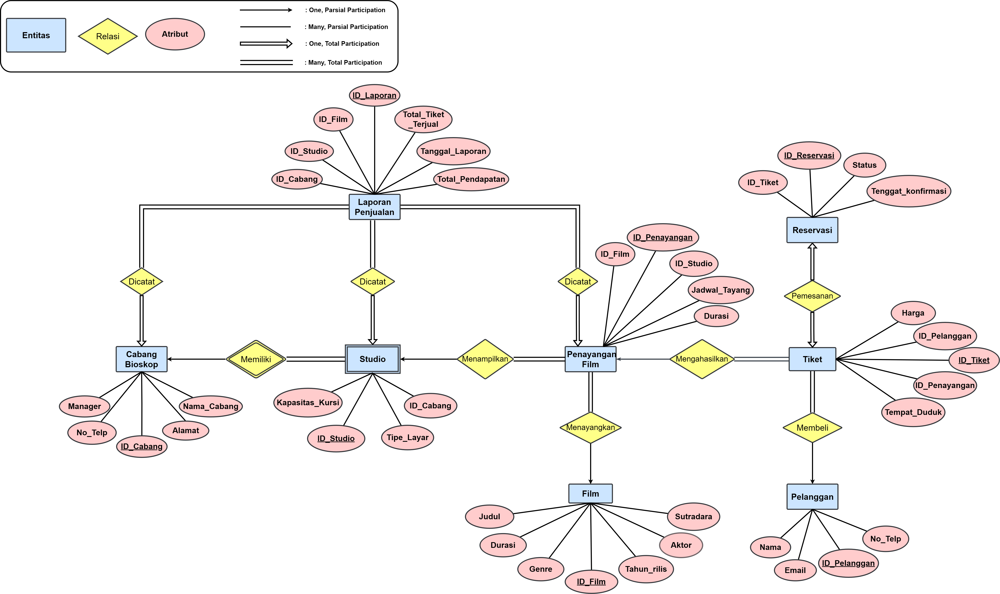

# CineMath Cinema Network: Relational Database Architecture and ERD Modeling
### Enterprise Database Conceptual Design, Cardinality Matrix, Weak Entity Resolution, and PostgreSQL DDL Implementation

[](sql/cinemath_schema.sql)
[]()
[](CineMath_Cinema_Database_Design.pdf)
[]()

---

## Project Overview

**CineMath Network** is a nationwide cinema chain operating multiplex theaters across Indonesia. To streamline theatrical screening operations, ticket sales, customer accounts, and auditorium schedules, the enterprise requires a centralized relational database architecture capable of managing physical venues, multi-format theater screens, synchronized showtimes, and real-time ticketing reservations.

This project delivers an end-to-end conceptual and physical database design for the CineMath Network enterprise, covering:
1. **Fundamental ERD Theoretical Foundations:** Clear formal definitions of entities, attributes, relationships, cardinality ratios, and participation constraints.
2. **Conceptual Entity-Relationship Modeling (ERD):** Structuring entities, composite attributes, multivalued attributes, and cross-entity associations.
3. **Cardinality and Structural Participation Formulation:** Enforcing business rules governing theater branches, auditoriums (*studios*), movie screenings, customer bookings, and sales reporting.
4. **Weak Entity Set Resolution:** Structuring discriminating composite identifiers for dependent physical assets.
5. **Physical Schema Implementation (DDL SQL):** Constructing a complete, 100% executable Data Definition Language script across all 8 tables with foreign keys and cascading referential integrity.

---

## Understanding Entity-Relationship Diagrams (ERD)

An **Entity-Relationship Diagram (ERD)** is a visual modeling tool in database engineering used to represent the conceptual structure of a database prior to physical implementation. It defines the core data objects, their internal properties, and how they interact within a business domain.

Key components of an ERD include:
* **Entities:** Real-world objects, events, or concepts that hold data (e.g., *Film*, *Customer*, *Studio*). Represented visually as rectangles.
* **Attributes:** Properties or characteristics describing an entity (e.g., *film_id*, *ticket_price*, *seat_number*). Represented as ovals:
  * *Primary Key:* Unique identifier for each entity instance (underlined).
  * *Composite Attribute:* Attributes that can be divided into smaller sub-parts (e.g., *Address* $\rightarrow$ Street, City, Postal Code).
  * *Multivalued Attribute:* Attributes that can hold multiple values for a single entity (represented by double ovals, e.g., *List of Actors*).
* **Relationships:** Associations or interactions connecting two or more entities (e.g., a *Customer* **buys** a *Ticket*). Represented as diamond shapes.
* **Cardinality Ratios:** Specifies the maximum number of entity instances that can participate in a relationship:
  * *One-to-One (1:1):* An instance of Entity A relates to at most one instance of Entity B (e.g., *Reservation* to *Ticket*).
  * *One-to-Many (1:N):* An instance of Entity A relates to multiple instances of Entity B (e.g., *Cinema Branch* to *Studios*).
  * *Many-to-Many (M:N):* Multiple instances on both sides associate dynamically.
* **Participation Constraints:** Specifies the minimum presence requirement:
  * *Total Participation (Double Line):* Every entity instance must participate in the relationship (mandatory existence).
  * *Partial Participation (Single Line):* Only some instances participate in the relationship (optional).

---

## Business Requirements and System Specifications

The CineMath Network database architecture satisfies specific enterprise workflows:

* **Movie Catalog (`Film`):** Tracks unique film identifiers, titles, genres, duration, release years, and multivalued arrays of cast actors and directors.
* **Theater Venues (`Cabang_Bioskop`):** Manages regional cinema multiplex locations with branch names, operational managers, contact telephone numbers, and composite address attributes.
* **Screening Auditoriums (`Studio`):** Represents screening rooms categorized by display technology (e.g., *2D, 3D, IMAX*) and seating capacity.
* **Showtime Schedule (`Penayangan_Film`):** Couples films with designated studios on scheduled dates and commencement timestamps.
* **Customer Accounts & Ticketing (`Pelanggan` & `Tiket`):** Manages registered customer profiles and unique ticket issuances mapped to specific seat numbers and screening sessions.
* **Reservation Lifecycle (`Reservasi`):** Handles advance bookings with confirmation deadlines and automated cancellation triggers.
* **Sales Auditing (`Laporan_Penjualan`):** Aggregates branch revenue, studio occupancy, and ticket sales metrics.

---

## Entity-Relationship Diagram (ERD)

The complete conceptual schema comprises **8 core entities** interconnected via structural constraints:



---

## Structural Cardinality and Participation Matrix

| Relationship Name | Interconnected Entities | Cardinality Ratio | Entity Participation (Domain Rules) |
| :--- | :--- | :---: | :--- |
| **Memiliki (Branch to Studio)** | `Cabang_Bioskop` to `Studio` | One-to-Many (1:N) | • **Branch:** Partial (a branch can exist prior to studio provisioning)<br>• **Studio:** Total (every studio must belong to a branch) |
| **Menampilkan (Studio to Show)** | `Studio` to `Penayangan_Film` | One-to-Many (1:N) | • **Studio:** Partial (auditoriums may be idle)<br>• **Show:** Total (each screening must run in a designated studio) |
| **Menayangkan (Film to Show)** | `Film` to `Penayangan_Film` | One-to-Many (1:N) | • **Film:** Partial (catalog films may not be actively screening)<br>• **Show:** Total (every screening must feature a film) |
| **Menghasilkan (Show to Ticket)** | `Penayangan_Film` to `Tiket` | One-to-Many (1:N) | • **Show:** Partial (newly opened shows may have 0 tickets sold)<br>• **Ticket:** Total (tickets cannot exist without a valid show) |
| **Membeli (Customer to Ticket)** | `Pelanggan` to `Tiket` | One-to-Many (1:N) | • **Customer:** Partial (registered users may not have purchased yet)<br>• **Ticket:** Total (all issued tickets must belong to a customer) |
| **Pemesanan (Reservation to Ticket)** | `Reservasi` to `Tiket` | One-to-One (1:1) | • **Reservation:** Total (reservations exist solely for tickets)<br>• **Ticket:** Total (reserved tickets are locked to a reservation) |
| **Dicatat (Reporting Logs)** | `Cabang / Studio / Show` to `Laporan` | One-to-Many (1:N) | • **Physical Entities:** Total participation in corporate sales auditing |

---

## Weak Entity Set Resolution

### Modeling Auditoriums as Weak Entities
Within the multiplex architecture, an auditorium/studio cannot be uniquely identified in isolation by its local studio number (e.g., *Studio 1* exists redundantly across multiple branches):
* **Weak Entity:** `Studio`
* **Identifying Entity:** `Cabang_Bioskop` via the *Memiliki* relationship.
* **Partial Key (Discriminator):** `id_studio`
* **Composite Primary Key:** `(id_cabang, id_studio)`

This composite structure ensures global entity uniqueness across national theater locations while preserving relational integrity.

---

## Physical SQL Implementation (DDL Schema)

The physical database schema is implemented with referential integrity constraints, primary keys, and cascading behaviors:

```sql
-- DDL Table Definition for Film
CREATE TABLE Film (
    film_id INT PRIMARY KEY,
    judul VARCHAR(100) NOT NULL,
    durasi INT NOT NULL,
    tahun_rilis INT NOT NULL,
    genre VARCHAR(50),
    sutradara VARCHAR(100),
    daftar_aktor TEXT -- Stored as delimited string or JSON array
);

-- DDL Table Definition for Tiket
CREATE TABLE Tiket (
    tiket_id INT PRIMARY KEY,
    harga DECIMAL(10, 2) NOT NULL, -- Currency value with 2 decimal precision
    tempat_duduk VARCHAR(10) NOT NULL, -- Seat notation (e.g., 'F2', 'C12')
    penayangan_id INT NOT NULL,
    pelanggan_id INT,
    FOREIGN KEY (penayangan_id) REFERENCES Penayangan_Film(penayangan_id) 
        ON DELETE CASCADE,
    FOREIGN KEY (pelanggan_id) REFERENCES Pelanggan(pelanggan_id) 
        ON DELETE SET NULL
);
```

*(The full Data Definition Language script creating all 8 tables in correct dependency order is available in [`sql/cinemath_schema.sql`](sql/cinemath_schema.sql)).*

---

## Project Deliverables

* [`CineMath_Cinema_Database_Design.pdf`](CineMath_Cinema_Database_Design.pdf): Presentation deck (Slides 2–12) focused exclusively on ERD modeling.
* [`sql/cinemath_schema.sql`](sql/cinemath_schema.sql): Complete, executable PostgreSQL DDL script establishing tables, primary keys, foreign keys, and integrity rules.
* [`diagrams/erd_diagram.png`](diagrams/erd_diagram.png): High-resolution Entity-Relationship Diagram sourced directly from design assets.
